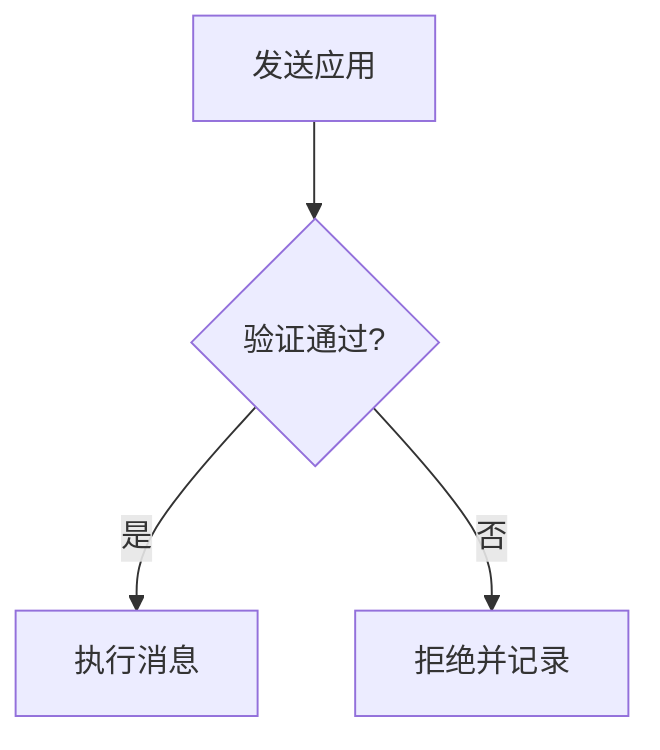
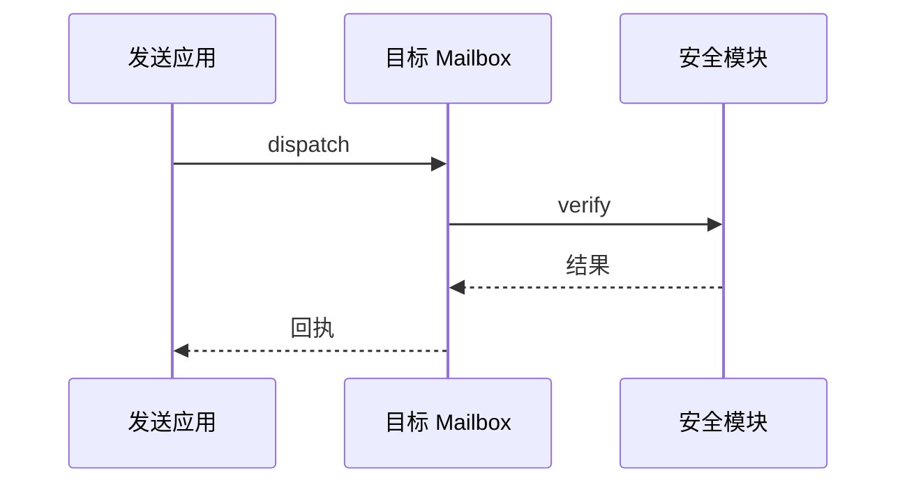

## 数学公式

行内公式保持正文节奏，例如 $E = mc^2$，块级公式单独占据一行：

$$
\int_0^1 x^2 \, dx = \frac{1}{3}
$$

多行推导也可以对齐：

$$
\begin{aligned}
(a + b)^2 &= a^2 + 2ab + b^2 \\
(a - b)^2 &= a^2 - 2ab + b^2
\end{aligned}
$$

## 代码高亮

围栏代码块按语言高亮，并沿用阅读主题的配色：

```ts
interface Mailbox {
  dispatch(domain: number, recipient: Uint8Array, body: Uint8Array): Uint8Array;
}

function quoteFee(messages: number, base: bigint): bigint {
  return base * BigInt(messages); // 每条消息一份费用
}
```

未知语言保持纯文本：

```text
plain text stays plain
```

## Mermaid 图表

流程图：



时序图：

